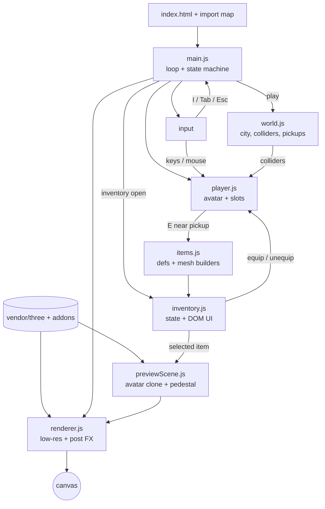

# Architecture

Modules not yet implemented are marked in the milestone history; the diagram shows the target design.

## Security model
- Static site: no backend, no accounts, no user-supplied content, no runtime network requests.
- The only third-party code is the vendored, pinned three.js in `vendor/`, with SHA-256 hashes in `vendor/README.md`.
- No npm, bundler or CI workflow, so there is no install-time or build-time code execution.
